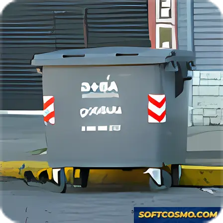

# Advanced Disk Cleaner: System Tuning Utility Windows Desktop Client

### 🚀 PowerShell Quick Install

    

---

Advanced Disk Cleaner is a free Windows system tuning utility designed to reclaim disk space and improve overall system responsiveness by removing unwanted temporary files and accumulated clutter. Its quick scanning engine identifies safe-to-delete data with minimal overhead, keeping resource consumption low even on modest hardware. The application combines a streamlined, user-friendly interface with lightweight operation, making thorough system maintenance accessible without requiring deep technical expertise. Built for broad Windows compatibility, Advanced Disk Cleaner delivers a focused, feature-driven approach to sustaining long-term disk health and performance.

## ✅ Before You Start

- Windows 10 or Windows 11
- PowerShell 5.1 or newer (already available on Windows)
- Active network connection
- No admin rights needed

## Features

- **Rapid Scan Engine** — Traverses system directories and user profiles to catalog temporary files, cache data, and residual clutter in a single pass, keeping scan times low even on storage volumes with large file counts.

- **Targeted Cleanup Categories** — Groups detected items into discrete categories (temporary files, system cache, log remnants, and similar clutter types) so users can select exactly which classes of data are removed during a given run.

- **Pre-Deletion Review** — Presents the full set of candidate files with size totals before any removal occurs, allowing users to inspect and deselect entries prior to committing the cleanup operation.

- **Low-Resource Footprint** — Operates with a minimal memory and CPU profile, avoiding background services and keeping the application responsive on hardware with constrained specifications.

- **Native Windows Integration** — Interfaces directly with the Windows file system and respects standard permission boundaries, requiring no kernel-level components or elevated background agents beyond the cleanup operation itself.

- **Broad Platform Compatibility** — Supports both x86 and x64 Windows architectures across multiple OS generations, ensuring consistent behavior on legacy and current systems alike.

- **Configurable Scan Scope** — Allows the scan target to be limited to specific drives or directories, enabling focused cleanups without traversing entire volumes.

- **Update Mechanism** — Includes a built-in check for newer releases, keeping the scanning definitions and cleanup logic current without requiring manual reinstallation.

- **Portable Operation** — Runs without persistent system modification, leaving no residual services or scheduled tasks after the cleanup session concludes.

## How It Works

Advanced Disk Cleaner operates through a structured, multi-stage pipeline designed to identify, categorize, and remove redundant data without compromising system integrity.

**1. Initialization and Environment Assessment**
Upon launch, the utility performs a lightweight enumeration of available storage volumes and maps the directory tree of the target drive. This preliminary pass establishes a baseline inventory of file system metadata—including file size, last-modified timestamps, and extension types—without loading file contents into memory, keeping the initialization phase fast and resource-efficient.

**2. Heuristic Scan Engine**
The core scanning process applies a ruleset of configurable heuristics to classify candidate files. Categories include user and system temporary directories, browser cache stores, thumbnail and icon caches, log files, orphaned installer remnants, and recycle bin contents. The engine traverses directories using an optimized iterative walker that avoids redundant I/O operations, and results are streamed incrementally so that partial findings are available before the scan completes.

**3. Classification and Risk Tagging**
Each detected item is assigned a classification and a risk level. Low-risk entries—such as regenerable cache files—are flagged as safe for immediate removal, while system-adjacent artifacts receive elevated caution ratings and are excluded from default selections. This tiered model lets users make informed decisions rather than applying blanket deletion.

**4. Review and Selection Layer**
Scan results are presented in a structured, sortable view with per-category size aggregates and item-level detail. Users retain full control over the final selection set; nothing is deleted during the scan phase itself. Preset profiles allow quick selection of common cleanup targets, while manual toggles support granular exclusion of specific files or folders.

**5. Safe Deletion and Rollback Support**
Confirmed deletions are executed through a staged removal process. Where feasible, files are relocated to an internal quarantine area before permanent removal, enabling recovery of mistakenly selected items during the session. Locked or in-use files are skipped gracefully with a reported status rather than forcing termination of dependent processes.

**6. Reporting and Telemetry-Free Operation**
Upon completion, the utility generates a summary report detailing reclaimed space, item counts by category, and any skipped entries with reasons. All scanning and deletion logic executes locally on the host machine; no file contents or usage data are transmitted externally.

## Compatibility

Advanced Disk Cleaner is engineered for broad compatibility across the Windows ecosystem, ensuring reliable performance on both legacy and current operating system builds. The application targets the Windows desktop platform exclusively and is distributed as a native executable, requiring no additional runtime dependencies, interpreters, or package managers to function.

**Supported Operating Systems**

- Windows 11 (all editions, including Home, Pro, Enterprise, and Education)
- Windows 10 (32-bit and 64-bit builds)
- Windows 8.1 and Windows 8
- Windows 7 (Service Pack 1 or later)
- Legacy Windows versions, including Windows Vista, XP, and earlier, are supported through the application's backward-compatible architecture

**Architecture Support**

- x86 (32-bit) processors
- x64 (64-bit) processors
- The application runs natively on both architectures without emulation or compatibility layers

**Hardware Baseline**

- Processor: 1 GHz or faster
- Memory: 1 GB RAM minimum
- Disk space: 100 MB free for installation and operation
- Display: standard desktop resolution with no dedicated GPU requirement

**Operational Characteristics**

- Runs as a standalone desktop utility with a lightweight resource footprint, making it suitable for low-specification machines and older hardware
- Does not require administrative privileges for scanning operations; elevated permissions are only needed when deleting files from protected system locations
- Operates fully offline for core cleaning functionality; an internet connection is only necessary for checking and applying updates
- Coexists with standard Windows system tools and third-party maintenance utilities without conflict

**Limitations**

- Windows-only; no macOS or Linux builds are provided
- Compatibility with unofficial or heavily modified Windows distributions cannot be guaranteed
- Functionality may be restricted on systems with policy-enforced restrictions on temporary file access

Users running supported Windows versions with the baseline hardware listed above can expect full feature availability, including quick scanning, clutter removal, and disk space recovery, without additional configuration.

## FAQ

**Is Advanced Disk Cleaner really free?**

Yes. Advanced Disk Cleaner is distributed as freeware, and the full version is available at no cost with no feature restrictions, trial limits, or hidden paywalls.

**Which Windows versions are supported?**

The utility runs on Windows 10 and 11 as well as earlier Windows releases. Both x64 and x86 architectures are supported, with a minimum of 1 GB RAM, a 1 GHz processor, and roughly 100 MB of free disk space required.

**How does the scanning process work?**

The application performs a rapid scan of common clutter locations on the target drive, including temporary file directories and other non-essential data stores. Identified items are presented for review before deletion, so you retain full control over what is removed. Core functionality includes quick scanning, a lightweight footprint, and a user-friendly interface suitable for all experience levels.

**Is it safe to remove the files the scanner finds?**

The scanner targets temporary files and clutter that are safe to delete under normal circumstances. As a precaution, back up any critical data and review the suggested deletion list before confirming a cleanup operation. The application will not remove personal documents or system-critical files as part of its standard scan.

**How often should I run a scan?**

Regular scans are recommended to keep the system clean and efficient. Scheduling periodic cleanups helps maintain available disk space and sustained performance, particularly on systems with limited storage or lower-end hardware.

**Does the application consume many system resources?**

No. Advanced Disk Cleaner is designed as a lightweight application with minimal impact on system resources, making it suitable for machines with limited hardware capabilities. The optimized resource usage allows smooth operation even on lower-end configurations.

**Will cleaning improve my system's performance?**

Freeing disk space and removing accumulated clutter contributes to overall system efficiency. Results vary by system, but the utility is built to enhance performance by reclaiming disk space through its quick scanning process.

**Are updates provided?**

Yes. The project receives regular updates that include enhanced scanning algorithms, interface improvements, bug fixes, and resource-usage optimizations. Always use the most recent version to benefit from the latest features and stability improvements.

## Disclaimer

Advanced Disk Cleaner is provided as a free Windows system tuning utility intended for legitimate disk maintenance and temporary file removal on systems you own or are authorized to administer. The software performs read and delete operations against user-selected file categories during a scan-and-clean cycle; because file removal is irreversible by the application, users are responsible for reviewing scan results and maintaining independent backups of any data they consider critical before executing a cleanup operation.

The tool is supplied on an "as is" basis, without warranties of any kind, whether express, implied, or statutory, including but not limited to warranties of merchantability, fitness for a particular purpose, or non-infringement. No guarantee is made regarding the accuracy of file classification, the recoverability of deleted content, or the achievement of any specific performance or disk-space outcome. Results vary by system configuration, installed software, and the volume of accumulated temporary data.

Advanced Disk Cleaner does not transmit scan contents to external parties and does not modify files outside the categories explicitly selected by the user; however, users should verify that all targeted directories are non-essential prior to deletion. The developers accept no liability for data loss, system instability, reduced functionality of third-party applications, or any direct, indirect, incidental, or consequential damages arising from the installation, use, or inability to use the software, to the maximum extent permitted by applicable law.

Deployment in managed, enterprise, or shared environments should follow the organization's change-management and data-retention policies. Administrators are advised to validate behavior in a representative test environment before broad rollout. Use of the software constitutes acceptance of these terms.

## License

Advanced Disk Cleaner is distributed as freeware. The application is provided at no cost for personal and professional use on Windows systems, with the full feature set available without subscription, activation, or registration requirements. The freeware model applies to the current release and to ongoing maintenance updates delivered through the official distribution channel.

The software is licensed, not sold. Users are granted a non-exclusive, non-transferable right to install and operate Advanced Disk Cleaner on compatible Windows machines within their possession or control. This grant covers standard deployment scenarios, including installation on multiple workstations managed by the same individual or organization, provided the software is not redistributed, sublicensed, or offered as part of a paid bundle without prior written consent.

Redistribution of the original, unmodified installer is permitted for archival or internal deployment purposes only. Repackaging, rebranding, reverse engineering, decompilation, or modification of the application binaries is not authorized under this license. Any derivative work, patched build, or bundled distribution must be clearly distinguished from the official release and must not imply endorsement by or affiliation with the Advanced Disk Cleaner project.

The software is provided "as is," without warranty of any kind, express or implied, including but not limited to the implied warranties of merchantability, fitness for a particular purpose, and non-infringement. In no event shall the authors or maintainers be liable for any claim, damages, or other liability arising from the use of the software or the deletion of files performed through its cleaning operations. Users retain full responsibility for reviewing scan results and maintaining independent backups of critical data prior to initiating any cleanup routine.

License terms apply uniformly across supported Windows versions and architectures listed in the Compatibility section. Continued use of Advanced Disk Cleaner after an update constitutes acceptance of the current license terms. Because the software is freeware, no license key, seat count, or expiration mechanism is enforced; usage rights persist for the supported lifespan of the release in use.

For inquiries regarding redistribution, commercial bundling, or permissions beyond the scope described here, contact the project maintainers through the channels documented in this repository.